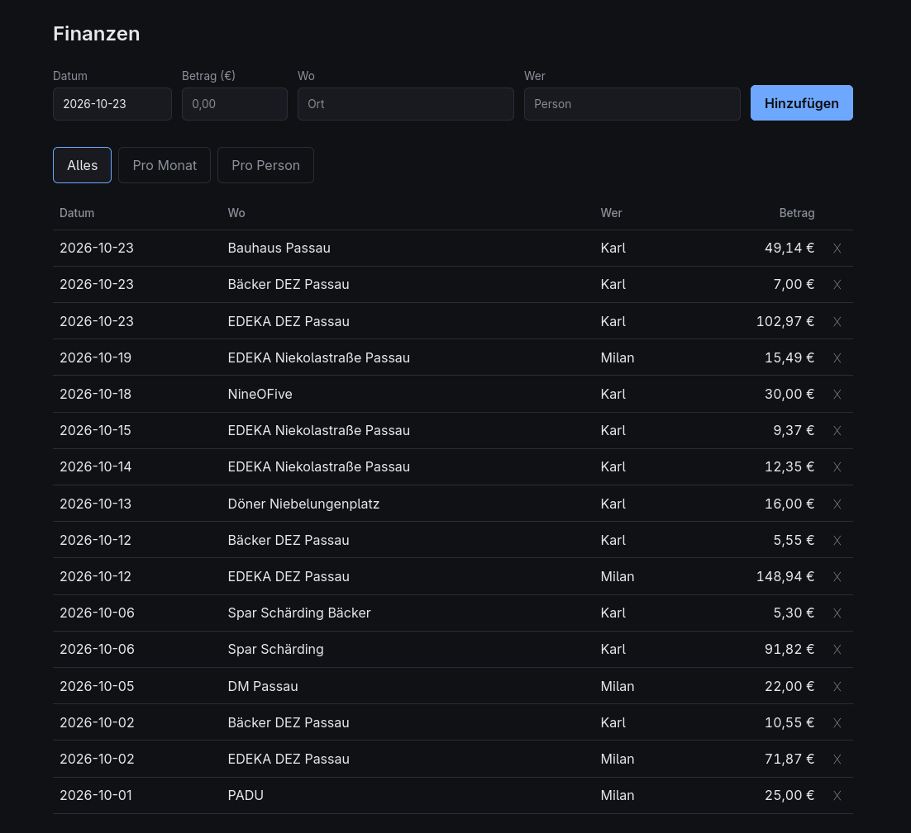
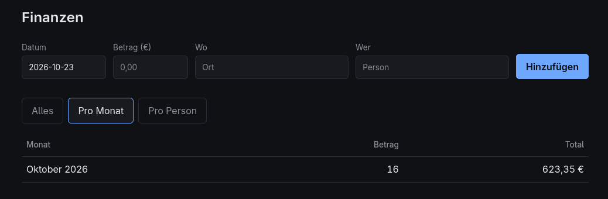
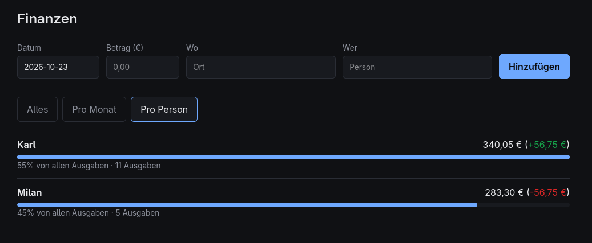

# Household expenses

A small selfhosted webapp for managning expenses in a household.

# How to run

    1. Clone the repo
    git clone https://github.com/miki2017milan/MoneyIsYours.git

    2. Go into the diretory
    cd MoneyIsYours

    3. Install npm packages
    npm install

    4. npm start

Data is stored in `expenses.db` which is created when running the app.
Change the port with `PORT=8080 npm start`.
The app UI is in german which can be changed when edeiting the html and css.

# Preview

